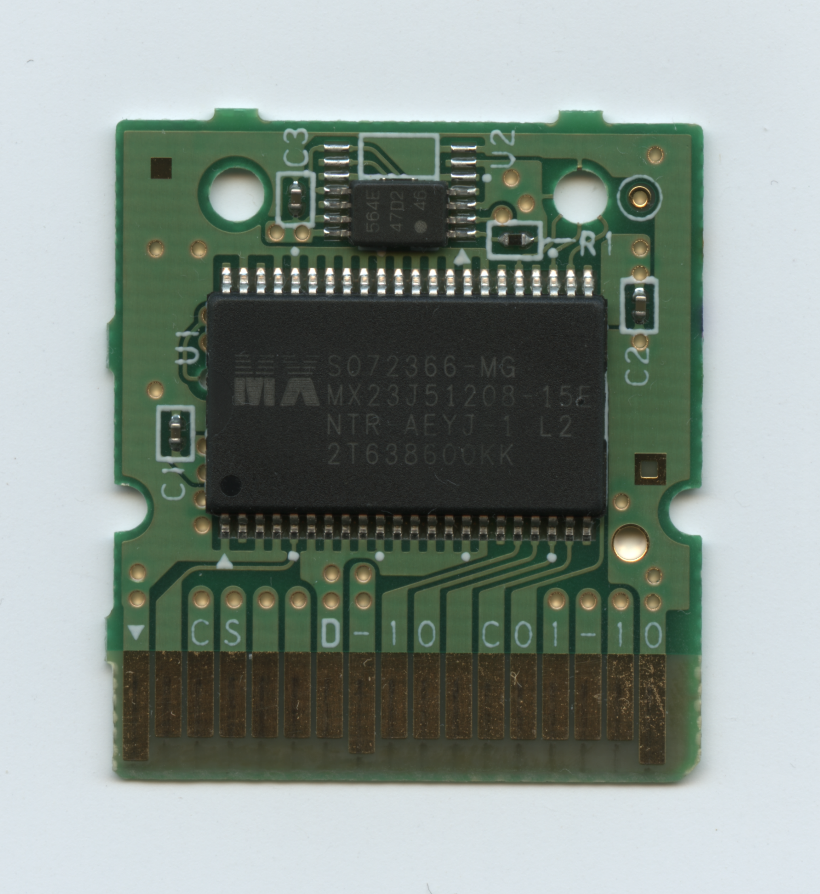
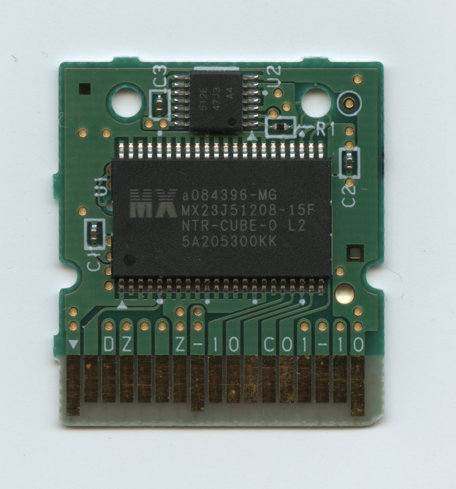
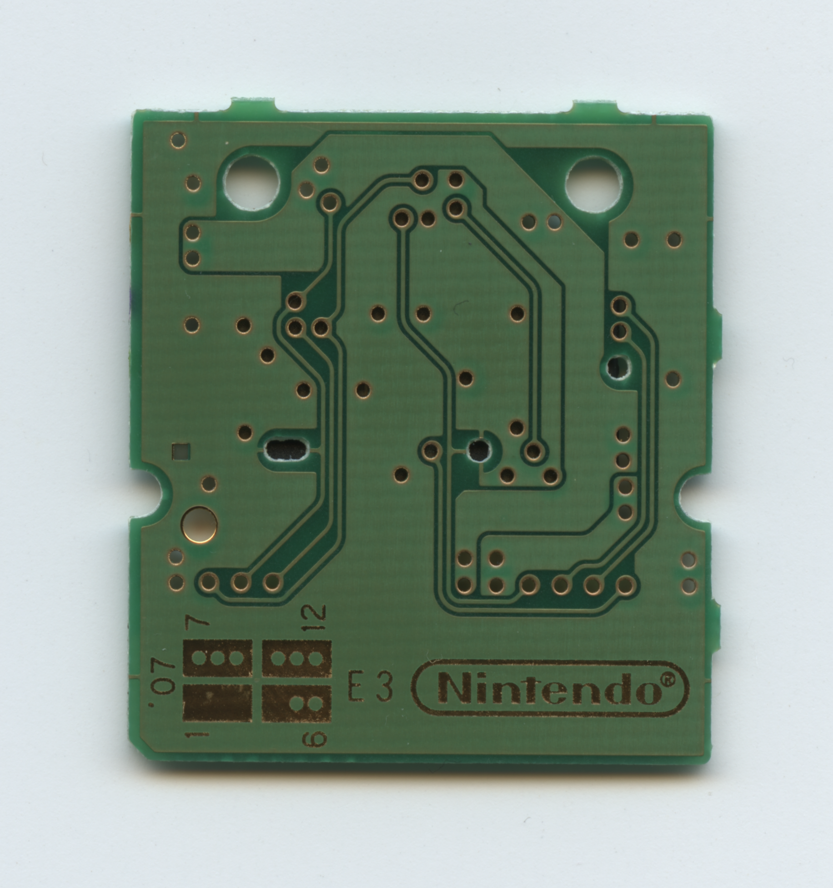
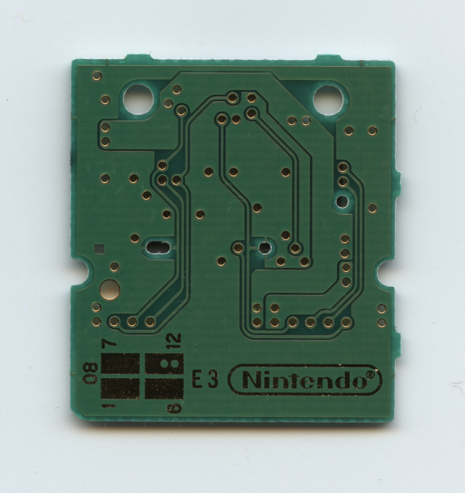
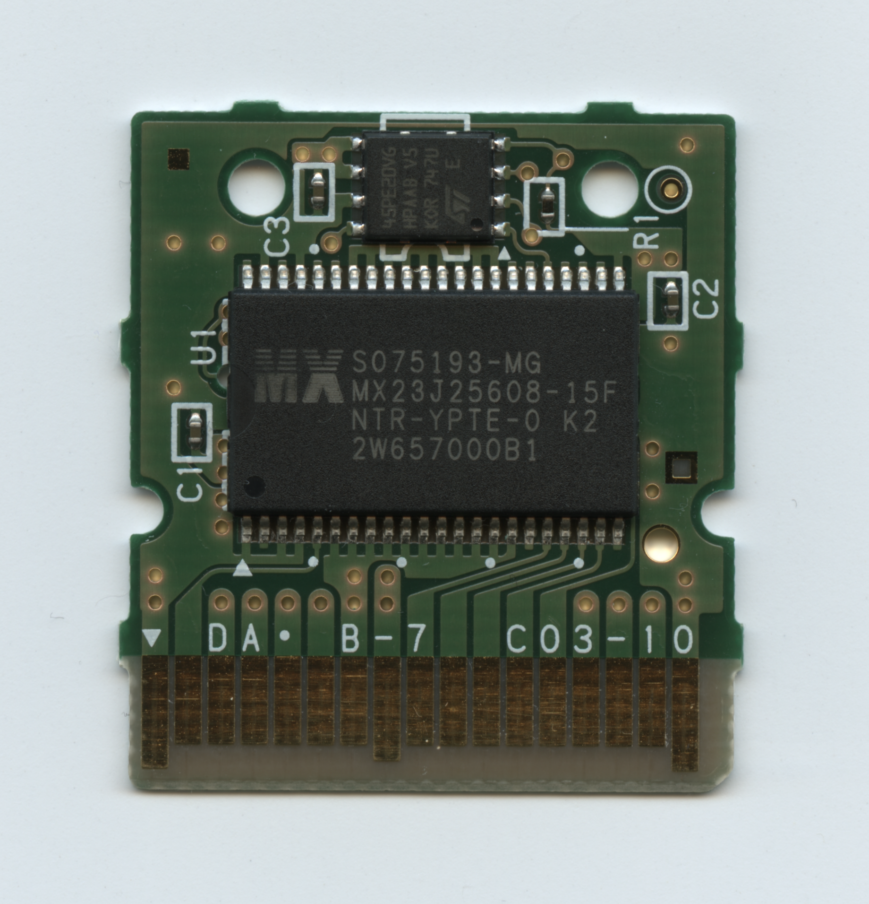
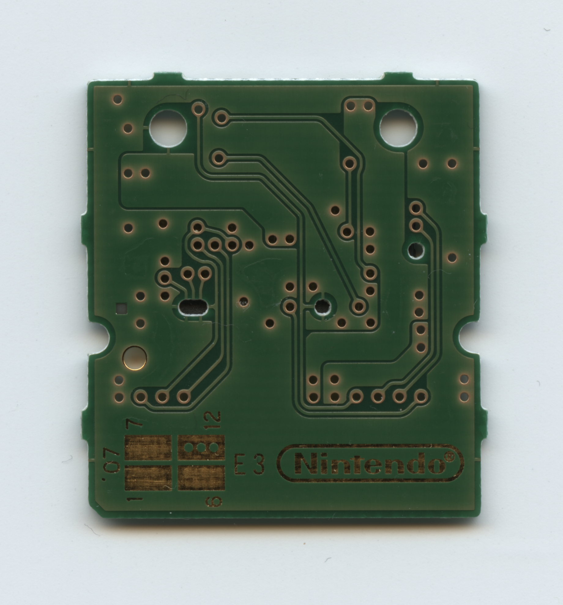

# NDS Cartridge Types

* Dont assume that the same board type uses the same save chip.

NTR-005 Board Types

| Board Type  | Front | Back |
| ------------- | ------------- | ------------- |
| C01-10 |  |  |
| C03-10 |  |  |

