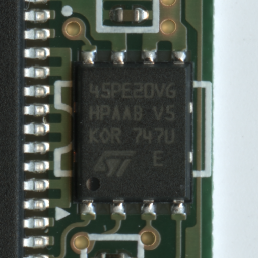
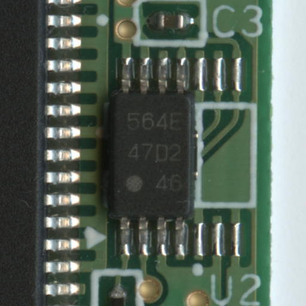
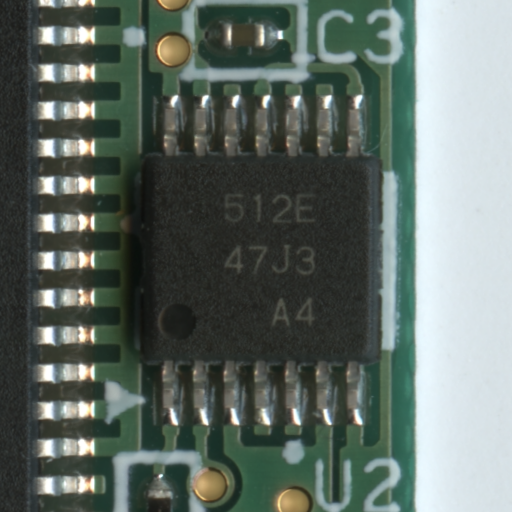

# NDS Cartridge : Save Chips

* The NDS uses a variety of chips and different types, SPI EEPROM/FLASH.

### EEPROM

| Identifier | Manufacture | Size | Package | Photo | Datasheet |
| ------------- | ------------- | ------------- | ------------- | ------------- | ------------- |

### FLASH

| Identifier | Manufacture | Size | Package | Photo | Datasheet |
| ------------- | ------------- | ------------- | ------------- | ------------- | ------------- |
| 45PE20VG | ST | 256KB / 2Mbit | QFN8 |  | [Datasheet](docs/CONTRIBUTING.md) |

### UNKNOWN

| Identifier | Photo | Cart Type |
| ------------- | ------------- | ------------- |
| 564E |  | [C01-10](../guides/NDS_CARTRIDGE_BOARD_TYPES.md) |
| 512E |  | [C01-10](../guides/NDS_CARTRIDGE_BOARD_TYPES.md) |