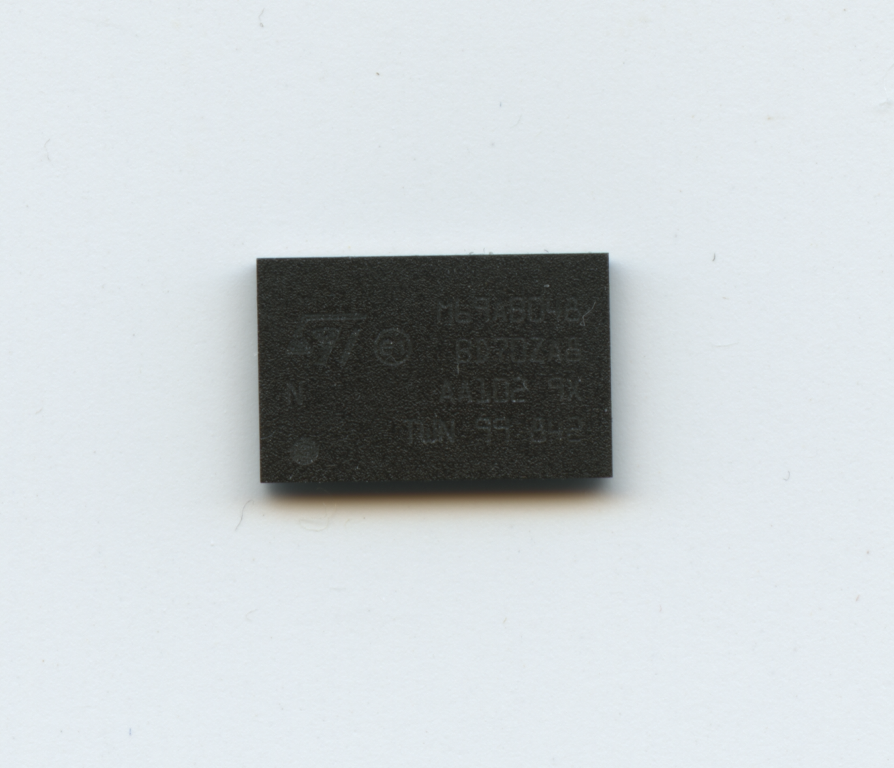
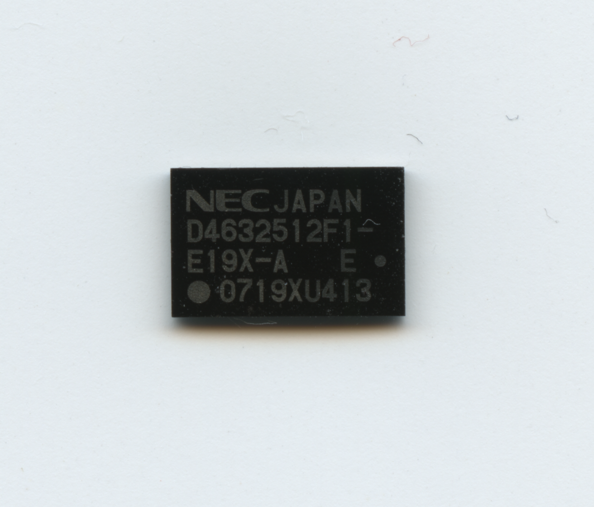
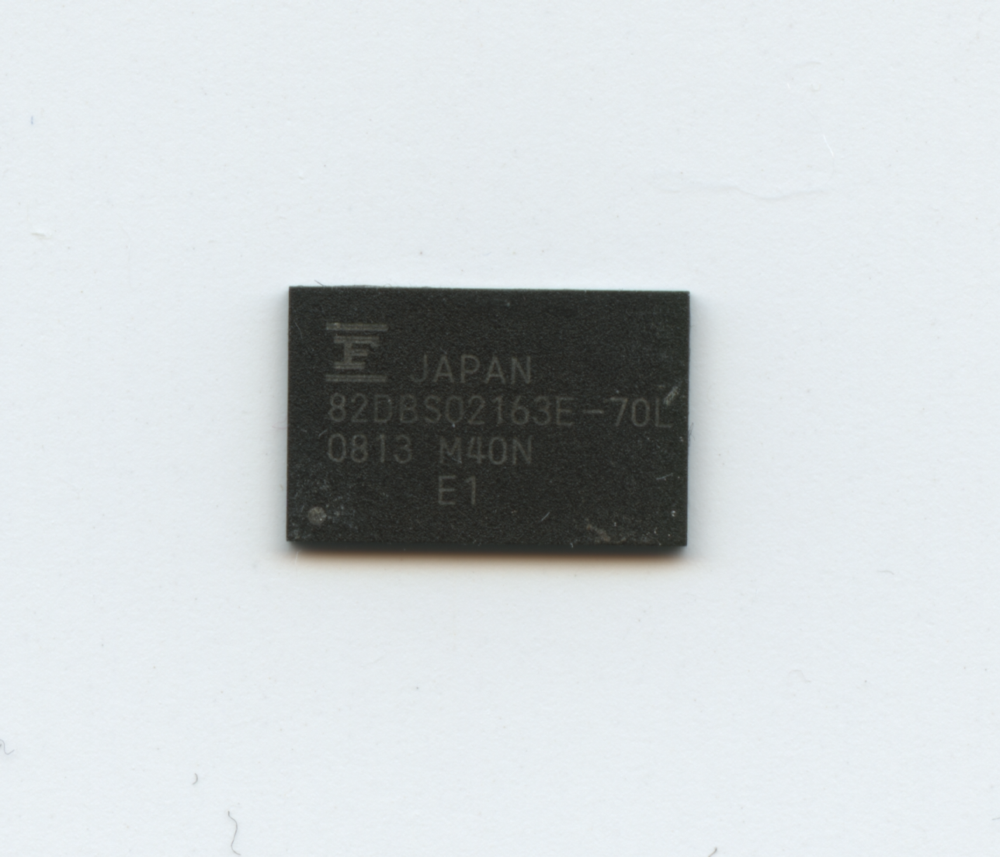

# NDS RAM

The NDS system seems to be using a variety of chips from various manufacturers.

## Specs:

- Size: Typically 4MB / 32Mbit
- Footprint: FBGA71 / BGA-71P-M03

## Chip List:

| Identifier | Manufacture | Image |
| ------------- | ------------- | ------------- |
| [M69AB048BD0](../datasheets/ST_M69AB048BD_M69KB048BD.pdf) | ST |  |
| D4632512F1-E19X-A | NEC |  |
| [82DBS02163E-70L](../datasheets/Fujitsu_MB82DBS02163C-70L.PDF) | Fujitsu |  |